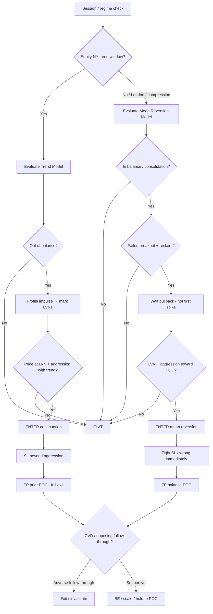

# Order Flow Trading Research — Video Knowledge Report

**Video:** [Trading LIVE with a World TOP Ranked Scalper (EXTREME Accuracy)](https://www.youtube.com/watch?v=tvERE-Beu2U)  
**Channel:** Chart Fanatics (host: Ritz)  
**Instructor / guest:** Fabio Valentini (also styled Fabia/Fabio Valentina in auto-captions)  
**Instrument focus in video:** NASDAQ / equity index futures (ES/NQ class), intraday scalping  
**Primary sources used for this report:**
1. **Video-derived:** YouTube page auto-caption / transcript text for `tvERE-Beu2U` (full spoken content captured via fetch).
2. **Instructor-affiliated writeup:** [Chart Fanatics — Auction Market Strategy](https://www.chartfanatics.com/strategies/auction-market-strategy) (same model; treated as supporting clarification of rules already stated on video, not as independent proof of edge).
3. **External research / engineering judgment:** labeled separately below.
4. **Genesis Signal Engine audit:** local codebase (`packages/orderflow`, validation docs).

**Access note:** Live video stream / platform chart UI could not be visually scrubbed frame-by-frame in this environment. Analysis is based on the **complete caption transcript** plus the instructor’s published strategy PDF page. No fabricated candle-by-candle chart claims beyond what the transcript and published writeup describe.

**Critical honesty:** Profitability claims in the video (e.g. “500% return”, Robins Club rankings, “+20–30% win rate”) are **unverified marketing/self-reported**. This report does **not** treat them as evidence.

**Code status:** Analysis only. **No Signal Engine code was modified.**

---

## 1. Complete Video Knowledge Report

### 1.1 What the video actually is

A long-form Chart Fanatics interview + live/chart walkthrough. Structure:

| Segment | Content |
|--------|---------|
| Intro / positioning | Host frames Fabio as elite futures scalper; performance claims |
| Conceptual teaching | Why naive market-structure trend-following fails without profile context |
| AMT framing | Balance vs imbalance as the gate for when a model is “allowed” |
| Three-step model | Market state → Location (VP / LVN) → Aggression (OF / bubbles / CVD) |
| Two playbooks | Trend (out-of-balance continuation) and Mean reversion (failed breakout → POC) |
| Risk management | Small % risk, BE early via CVD, stop just beyond aggression, daily loss cap |
| Chart demos | Deep chart / order-flow platform: VP, VAH/VAL/POC, delta-by-price, filtered large prints |
| Live NY session commentary | Pre-open caution, squeeze narrative, scale-out, psychological rules |
| Sponsors | Apex, TradeZella, FundedNext / ProperTrader — ignore for methodology |

### 1.2 Core thesis (video-derived)

1. Markets auction between **balance** (fair value rotation) and **imbalance** (one-sided aggression seeking new value).
2. Most retail losses come from trading **structure patterns inside balance** as if they were trends.
3. Edge is not prediction; it is **waiting until state + location + aggression align**.
4. Volume Profile maps *where* to trade; Order Flow validates *whether* participation confirms.
5. Two complementary models cover trend days and range/compression days — **wrong model in wrong regime destroys expectancy**.

### 1.3 Instructor’s explicit three-step stack

```
Market State  →  Location (Profile / LVN)  →  Aggression (OF trigger)
     ↓                    ↓                           ↓
 Balance vs          Where to refine             When to click
 Imbalance           entry / alerts              (bubbles, delta, CVD)
```

If any step is missing → **no trade**.

---

## 2. Timestamp-Based Concept Breakdown

Timestamps below are from caption/summary alignment (approx. ±15–30s). Concepts listed are **video-derived** unless noted.

| Timestamp | Concept | What was said / shown |
|-----------|---------|------------------------|
| 00:00–01:50 | Intro / claims | Elite scalper framing; live NY candle walk tease |
| 01:50–03:40 | Market structure misconception | BOS/CHoCH/OB trend-follow without profile context fails |
| 03:40–04:30 | Fair value / distribution | Pattern inside day’s bell curve → only ~30% “go through”; rest stay in value |
| 04:30–06:30 | Auction Market Theory | Balance ↔ imbalance; market usually in balance |
| 05:24–06:10 | Wait for out-of-balance | Claimed +20–30% win-rate lift vs trading every pattern |
| 06:30–07:20 | Model vs strategy | “Model” adapts to narrative; rigid rules without context fail |
| 07:00–07:40 | Regime / news gap | Iran/geopolitics gap example — don’t expect Friday behavior |
| 07:40–08:50 | Location + inefficiency | Supply/demand; “FVG” reframed as one-sided aggression / momentum |
| 08:50–10:50 | Order flow as alphabet | Prefer OF over multi-TF candle guessing for location precision |
| 10:00–11:20 | LVN refinement | Profile A→B of impulse; LVNs as reaction/continuation levels (Carmen Rosato nod) |
| 10:50–12:30 | Aggression trigger | Large prints / “bubbles”; stop beyond aggression; swim with flow |
| 12:30–13:10 | Target = prior balance / POC | Market seeks balance; don’t stretch R:R past statistical value |
| 15:50–17:40 | Session timing | Trend model best in **NY** equities; London first hour fakeouts |
| 17:30–19:50 | Mean-reversion model | Balanced market: wait first breakout fail/reclaim, then aggression; BE fast |
| 19:50–21:20 | Risk sizing | ~0.25% personal / ~0.5% competition context; wrong immediately |
| 21:20–23:30 | OF vs VP horizon | Short-term: OF; large capital / longer: VP; OF principles more universal than PA |
| 23:30–25:50 | Objectivity | Contract filters (e.g. 30 NQ) more objective than subjective BOS |
| 25:50–28:30 | Lagging / realtime / leading | Indicators lag; price realtime; volume/CVD leading pressure |
| 26:15–28:30 | CVD for management | Use CVD to move to BE earlier than price-structure alone |
| 28:17–31:20 | Auction analogy | Price searches for participation; builds new balance / POC |
| 35:55–37:30 | Edge decay | PA rules decay with volatility; OF reads mechanics |
| 36:46–38:00 | Unsupported continuation | CVD/footprint show aggression against break-retest → skip |
| 39:30–43:30 | Trend model recap | NY only overnight avoid; state=imbalance; LVN alert; red/green ball; full exit at POC (~70% reverse claim) |
| 43:30–46:50 | Mean-reversion recap | Consolidation; second swing; target POC not far VA extreme; stop 1–2 ticks inside high |
| 46:50–48:40 | Prior-day profile | Simple balance = previous day profile; delta-at-price for breakout quality |
| 50:15–57:40 | Pros/cons + psychology | Many small stops; full-time focus; no revenge; don’t invent bias setups |
| 58:50–01:06 | Chart: consolidation VP | VAH/VAL/POC; reversion to value; NY impulse + LVN + buy aggression |
| 01:06–01:14 | VSA / follow-through | Sellers punch wall / no follow-through → exit or flip narrative |
| 01:13–01:18 | Failed breakout → POC | Out of balance print fails → rebalance to POC |
| 01:23–01:29 | Pre-open | Don’t force pre-NY; clarity often 15–30m after open |
| 01:31–01:32 | Print filters | ~30 contracts NY / ~20 London (NQ context) |
| 01:38–01:39 | Spoofing caution | Prefer **executed** market orders over resting limit optics |
| 01:47–02:00 | Squeeze | Trapped aggressive side → acceleration when covered |
| 02:11–02:25 | Risk numbers | 0.25–0.5% (to 1% after large run); **2% daily max loss** |
| Later live | Scale-out / BE | Partial once risk-free; build day profit; risk only day’s profits later |

---

## 3. Concept Encyclopedia

### Legend
- **V** = discussed/demonstrated in video (video-derived)
- **E** = external microstructure research / standard definition (not claimed as video content)
- **R** = recommendation for Genesis (engineering judgment)

For each **V** concept: meaning, mechanism, why it matters, chart ID, bull/bear, mistakes, strategy use.

### 3.1 Video-derived concepts (V)

#### Order Flow Analysis (V)
- **Meaning:** Reading executed aggressive flow (who lifted offer / hit bid), not just OHLC.
- **How:** Large prints, footprint imbalances, CVD, delta-at-price.
- **Why:** Turns location into a confirmed transaction, not a guess.
- **Chart ID:** Bubbles/balls, footprint cells, CVD line vs price.
- **Bull:** Large buy prints + rising CVD at LVN in up-impulse.
- **Bear:** Large sell prints + falling CVD at LVN in down-impulse.
- **Mistakes:** Treating resting DOM size as “institutions”; ignoring follow-through.
- **Strategy:** Step-3 trigger only after state + location.

#### Market Structure (V — critically reframed)
- **Meaning:** Instructor acknowledges BOS/CHoCH/OB language but says it fails without profile context.
- **How:** Structure gives *candidate* direction; profile says if that direction is statistically favored.
- **Why:** Prevents trading “trend patterns” inside value.
- **Mistakes:** Pattern-first trading; subjective multi-TF BOS definitions.

#### Buy-side / Sell-side Liquidity (V — lightly / skeptically)
- **Meaning:** Mentions springs/liquidation/liquidity-seeking as *labels people use*, then says that often isn’t what’s “behind the curtains.”
- **How in his model:** Prefer auction + aggression over liquidity-hunt mythology.
- **E note:** Liquidity pools still matter mechanically (stops clustered beyond highs/lows); video does not build ICT-style SSL/BSL rules.

#### Institutional Order Flow (V — cautious)
- **Meaning:** Claims floors/discretionary desks still watch OF/VP; most flow is algo.
- **How he operationalizes:** Size filters (e.g. 20–30 contracts), not “smart money” labels.
- **Mistakes:** Equating large print with “institution.”

#### Buying / Selling Pressure (V)
- **Meaning:** Persistent aggressive volume on one side.
- **ID:** CVD slope, stacked imbalances, print density.
- **Bull/Bear:** CVD rising with price / falling with price; divergence = warning.

#### Market Orders vs Limit Orders (V)
- **Meaning:** Aggression = marketable orders; spoofing risk on visible limits.
- **Strategy:** Trust prints; be skeptical of book optics.

#### Volume Analysis / Volume Imbalances (V)
- **Meaning:** Volume at price + footprint ask/bid imbalance; “inefficiency” = one-sided aggression.
- **ID:** LVN vs HVN; footprint stacked imbalance; delta-at-price extremes.

#### Footprint Charts (V)
- **Meaning:** Bid×Ask (or sell×buy aggressor) volume per price inside a bar.
- **Use:** Confirm aggression at LVN; detect unsupported break-retest.

#### Cumulative Volume Delta (CVD) (V)
- **Meaning:** Running sum of buy-aggressor minus sell-aggressor volume.
- **Use:** Leading pressure; earlier BE; skip unsupported continuations.
- **Mistakes:** Using session CVD alone as entry (your engine already rejects this in A+).

#### Delta Analysis (V)
- **Meaning:** Per-bar or per-price aggressor imbalance.
- **Use:** Breakout quality (huge sell delta on upside break = birthday short setup in his words).

#### Absorption (V — demonstrated as behavior)
- **Meaning:** Aggression into a level without progress (sellers “punch a wall”).
- **ID:** Large opposing prints + weak follow-through / wick / flat CVD response.
- **Use:** Exit or flip narrative; mean-reversion confirmation.

#### Aggressive Buying / Selling (V)
- **Meaning:** Filtered large marketable prints (“green/red balls”).
- **Filters stated:** ~30 NQ NY, ~20 London (instrument-specific; not portable raw to crypto lots).

#### Liquidity Sweeps (V — not a named playbook)
- Discussed more as failed auctions / stop runs at highs-lows accelerating slippage; not a formal SSL/BSL strategy.

#### Auction Market Theory (V — central)
- Balance = efficient two-sided trade around value; imbalance = search for new value.
- Markets spend more time in balance → trend entries inside balance overtrade.

#### Volume Profile / POC / VAH / VAL (V)
- POC = max volume price (“P”); value area ≈ high-volume region (blue band in demo).
- Targets: prior balance POC; avoid stretching to low-probability extremes.
- Prior-day profile = simple balance definition.

#### Market Acceptance / Rejection (V)
- Acceptance: build volume / hold outside value → new balance.
- Rejection: poke outside value → return to POC / value.

#### Entry Confirmation (V)
- Triple alignment: imbalance (or failed-break context) + LVN location + aggression with follow-through.
- Explicitly: **do not enter first drive**; wait confirmation / second swing for MR.

#### Stop Loss / Take Profit (V)
- SL: just beyond aggressive print; optionally 1–2 ticks *inside* obvious high/low to reduce stop-run slippage.
- TP: prior POC / balance; often **full exit** (claims ~70% reverse from balance).
- Manage: BE early if CVD confirms; scale/partial once risk-free in live examples.

### 3.2 External research addendum (E) — not claimed as video content

| Topic | Brief note |
|-------|------------|
| Aggressor classification | Exchange buyer-is-maker / taker flags are best; tick rule is inference |
| Crypto vs futures prints | Contract-size filters do not transfer 1:1; use relative size / percentile |
| LVN automation | Percentile LVN ≠ discretionary “gap in profile” of impulse leg |
| CVD divergence | Common false positives in chop; needs location context |
| DOM spoofing | L2 cancel/replace high; executed tape more reliable |
| Prop-firm / contest returns | Survivorship + payout rules ≠ transferable retail expectancy |
| Session clocks | NY/London rules are equity-index specific; crypto is 24/7 |

---

## 4. Instructor Methodology Reconstruction

### 4.1 Answers to the 10 methodology questions (video-derived only)

1. **Market direction:** From auction state + aggression side. Imbalance direction = continuation bias. Failed breakout of balance = mean-reversion toward POC. Not from indicator stack.
2. **Important levels:** Volume Profile on prior day and/or impulse/compression window → POC, VAH/VAL, especially **LVNs** on the impulse leg.
3. **Liquidity’s role:** Secondary. He reframes “liquidity hunt” as often mislabeled; slippage clusters beyond highs/lows matter for stop placement. Price seeks **balance**, not “liquidity” as primary ontology.
4. **Valid setup conditions:** Session window appropriate to model + clear balance/imbalance state + refined location + aggression confirmation + follow-through. Missing any → flat.
5. **BUY confirmation:** Out-of-balance upside (trend) or failed downside break + reclaim (MR) + price into LVN + large buy aggression / bullish delta + preferably CVD support.
6. **SELL confirmation:** Mirror of above with sell aggression / bearish delta.
7. **Entries:** Near LVN on alert (not blind limit); click when aggression prints; prefer earlier in impulse vs late chase.
8. **Stops:** Beyond the aggressive print / invalidation of the trigger; sometimes 1–2 ticks inside swing extreme; never widen.
9. **Targets:** Previous balance POC (primary); occasionally trail on exceptional trend day; avoid low-probability far extremes as default.
10. **Invalidation:** Opposite aggression with follow-through; acceptance beyond stop/LVN; failed reclaim; compression returning without continuation; narrative break of balance level against position.

### 4.2 Trend Model — step-by-step (bullish example)

1. **Timing:** New York session (equities). No overnight hold.
2. **State:** Price displaces away from prior value — clear imbalance / momentum, not rotation.
3. **Location:** Profile the impulse leg; mark LVNs; set alert slightly before LVN.
4. **Trigger:** On pullback into LVN, require large **buy** aggression (filtered prints / footprint imbalance).
5. **Entry:** Long on confirmation (not first blind drive).
6. **Stop:** Just below aggressive buy cluster / LVN invalidation (tight).
7. **Target:** Prior balance POC — typically full exit.
8. **Manage:** If CVD surges with price, BE early; exit if opposing aggression gains follow-through.

### 4.3 Trend Model — bearish example

Mirror: imbalance down → LVN in sell impulse → large sell prints → stop above aggression → target prior POC below/above as appropriate → full exit at balance.

### 4.4 Mean Reversion Model — bullish example (failed breakdown)

1. **Timing:** Often London / compression / summer chop (his stated preference for this model).
2. **State:** Balance / consolidation (prior-day profile or visible compression).
3. **Event:** Price breaks below value, fails to accept, reclaims inside balance.
4. **Wait:** Do **not** buy the first spike; wait pullback after reclaim.
5. **Location:** LVN on reclaim leg.
6. **Trigger:** Buy aggression on pullback.
7. **Stop:** Beyond aggressive print / failed extreme (optionally 1–2 ticks inside high/low of failed poke when shorting the opposite).
8. **Target:** Balance **POC** (not necessarily opposite VA extreme).

### 4.5 Mean Reversion — bearish example (failed breakout)

Price pokes above VAH/balance → no acceptance → reclaim inside → pullback to LVN → sell aggression → stop above failed high → target POC.

### 4.6 What was **not** fully specified (do not invent)

- Exact quantitative definition of “out of balance” (ATR multiple, VA distance, time outside value, etc.).
- Exact LVN detection algorithm.
- Exact print-size thresholds for non-NQ markets.
- Exact CVD slope thresholds for BE.
- Formal position-sizing formula beyond % risk bands.
- Crypto adaptations.

---

## 5. Strategy Flowchart



---

## 6. Critical Evaluation (Phase 4)

### Strengths
- Clear **regime gate** (balance vs imbalance) before pattern trading.
- Location objectified via VP better than pure multi-TF candle subjectivity.
- Aggression + follow-through as confirmation reduces blind limit entries.
- Tight invalidation aligns with positive expectancy math if edge exists.
- Two models cover trend and range — conceptually sound.

### Weaknesses
- Heavy **discretion** admitted (“step 3 needs experience”; “cannot just automate”).
- Performance claims unverified; sponsor environment incentives.
- Equity session rules don’t map cleanly to 24/7 crypto.
- “70% reverse from balance / +20–30% WR” are anecdotes, not studies.
- Print filters are product/instrument-specific.
- Live demos susceptible to **hindsight narrative** (story fitted to prints after the fact).

### Best / worst conditions
| Better | Worse |
|--------|-------|
| Clear NY trend days with displacement | News spikes with empty book / gap chaos |
| Clean compression → failed auction | Persistent chop with many failed breakouts (many small stops) |
| Liquid futures tape with reliable aggressor flags | Thin books, spoof-heavy L2, poor aggressor data |

### False signals
- First breakout of balance (both models warn).
- Large print without follow-through.
- Structure pattern inside value.
- Late chase after LVN already traversed.
- Pre-open / first minutes noise.

### Repainting / hindsight
- Discretionary LVN drawing on completed impulse can be post-hoc.
- “Balance” boundaries chosen after seeing compression.
- CVD BE timing discretionary.
- Automated VP on fixed windows is less biased than freehand profiles.

### Data requirements
- Tick trades with aggressor side.
- Preferably footprint-capable aggregation.
- Volume-at-price over configurable windows (day, impulse, compression).
- Optional: filtered large-print stream.
- Session calendar (for equity logic).

### Execution limitations
- Scalp stops of a few ticks need low latency / good fills; crypto fees + slippage can erase edge.
- Human reaction window (15s–1m) vs bot — bots can be more consistent on triggers but worse on discretionary regime calls unless regime is quantified.

### Risk management requirements (as stated)
- 0.25–0.5% risk typical; daily max ~2%.
- Never widen stops; prefer immediate wrongness.
- Prefer full TP at POC over greedy runners as default.

### Proven mechanics vs personal assumptions

| More mechanical / widely accepted | Personal / unverified assumption |
|-----------------------------------|----------------------------------|
| Auctions rotate around high-volume nodes | Exact 70% POC reversal rate |
| Outside-value acceptance vs rejection | +20–30% WR from waiting for imbalance alone |
| Aggressor delta measures short-term pressure | OF has no edge decay |
| Clustered stops beyond swings worsen slippage | 1–2 ticks inside high always +EV |
| Session liquidity differs NY vs London for indices | Same filters/rules for all markets |

---

## 7. Application to Genesis Signal Engine (Phase 5)

### Current engine snapshot (relevant)
- Multi-confirm Signal Engine with A+ gates: HTF permission + real OF trigger + location + no conflict.
- Already has: footprint imbalances/absorption, CVD, DOM, VP (POC/VAH/VAL/HVN/LVN), structure, OB/FVG/sweeps, break/retest playbook, iceberg veto, paper validation freeze (Phase 8), strategy plugin surface (weight-0).
- Priority alignment: **paper trading**, **accuracy over signal count**, **do not remove existing functionality**.

### Mapping video concepts → engine

| Video concept | Already in engine? | Gap vs Fabio model |
|---------------|--------------------|--------------------|
| Multi-confirm / wait if incomplete | Yes (minIndependent, A+) | Strong overlap |
| VP POC/VAH/VAL/LVN | Yes | Impulse-leg / prior-day profile windows less explicit as first-class “balance state” |
| LVN continuation weight | Yes (`lvnContinuation`) | Not gated by explicit balance/imbalance regime |
| Stacked imbalance / bar delta | Yes | Large-print “bubble filter” percentile not first-class |
| CVD align / divergence | Yes | CVD-as-BE manager is lifecycle/risk, not fully Fabio-style |
| Break + retest | Yes (`breakoutRetest.ts`) | Close to MR “wait reclaim” — good hook |
| Absorption / unfinished auction | Yes (footprint heuristics) | Follow-through scoring could be stronger |
| Session NY/London gates | Partial / crypto 24h | Equity session logic not native |
| Balance vs imbalance regime gate | **Weak / missing as hard gate** | Highest-value add as **filter**, not replacement |
| Target = prior balance POC full exit | Structural TPs exist | POC-as-primary-TP policy optional |
| Stop beyond aggression print | Structure/swing stops | Aggression-anchored stop not primary |

### Measurable algorithmic features (candidates — design only)

1. **`auctionState`**: `BALANCE | IMBALANCE | UNKNOWN` from time-outside-value, VA migration, displacement vs ATR, rotation score.
2. **`balanceBounds`**: prior-day or rolling session VP → POC/VAH/VAL.
3. **`impulseProfileLvn`**: VP built only on last displacement leg; nearest LVN distance + side.
4. **`aggressionScore`**: percentile large prints in window; footprint stacked imbalance; delta z-score at level.
5. **`followThroughScore`**: price progress per unit adverse delta after print cluster (detect absorption vs continuation).
6. **`failedAuctionFlag`**: poke beyond VAH/VAL + reclaim + delta exhaustion.
7. **`pocMagnetTarget`**: distance/R to prior POC as TP1 candidate.
8. **`modelMode`**: `TREND_CONTINUATION | MEAN_REVERSION | OFF` from auctionState + session/regime.

### Real-time vs historical

| Feature | Real-time | Historical tape |
|---------|-----------|-----------------|
| CVD, footprint, large prints | Required live | Replayable if `trade_tape` complete |
| Session VP / POC | Live + daily reset | Reconstructable |
| Auction state | Live | Reconstructable |
| Discretionary “narrative” | Human | Not automatable reliably |
| DOM spoof judgment | Live L2 | Hard historically if book not archived |

### Hard to automate reliably
- True “experience” read of ambiguous aggression.
- Switching narrative mid-trade (squeeze stories).
- Freehand compression box selection.
- Geopolitical regime judgment (can use calendar proxies only).

### Possible redundancies (do **not** remove; consider down-weight later only after OOS)
- Pure structure trend without auction-state filter may compete with Fabio’s “stay flat in balance.”
- OB/FVG location may overlap LVN/impulse inefficiency — keep both until evidence shows collinearity harm.
- Session CVD as entry (already demoted in A+) remains correctly weak.

### False-signal filters to prototype (additive only)
1. **Hard WAIT in BALANCE for trend-continuation family.**
2. **Hard WAIT on first breakout bar** without reclaim/retest (aligns with breakRetest phases).
3. **Require aggressionScore ≥ threshold** co-located with LVN/location factor.
4. **Require followThroughScore** before CONFIRMED (not just a single print).
5. **Prefer TP1 = opposing POC** when auction mean-reversion mode active.
6. **Regime tag** compression vs expansion for paper strata (already have regime analytics hooks).

### Integration proposal (no code yet)

**Preferred path (preserves engine):**
1. Implement features as pure functions in `packages/orderflow` (new module e.g. `auctionModel.ts`).
2. Expose via `strategyPlugins` / confirmation pack as **weight-0 reasonsAgainst + evidence** first (Phase 11 pattern) under a feature flag.
3. Only after paper gates: optional **additive filter** that can force WAIT (like iceberg veto), never deletes existing factors.
4. Keep Phase 8 validation lock; new config fingerprint when filters enable.
5. Compare vs baseline fingerprint — require claimable sample before asserting accuracy lift.

---

## 8. Algorithmic Feature Specification (draft)

### Feature: `auctionState`

```
inputs: sessionVp, price, atr, lookbackBars
BALANCE if:
  - fraction of last N bars closing inside [VAL, VAH] >= τ_in
  - |close - POC| / ATR <= τ_poc
  - swing range / ATR <= τ_range
IMBALANCE if:
  - acceptance outside VA for M bars OR
  - displacement from POC >= κ * ATR with one-sided delta
else UNKNOWN
```

**Acceptance criteria for research build:** deterministic, unit-tested, labeled `derived`/`heuristic`, never “institutional.”

### Feature: `lvnAggressionTrigger`

```
inputs: impulseTrades[t0,t1], liveTrades, footprint, tickSize
- build VP on impulse window → LVNs
- nearLvn = dist(price, nearestLvn) <= proximityPct
- aggression = largePrintPercentile >= p90 OR stackedImbalance aligned
- followThrough = signed progress over next Δt after print
trigger = nearLvn && aggression && followThrough
```

### Feature: `failedAuctionReversion`

```
- poke beyond VAH/VAL
- reclaim inside VA within T bars
- pullback toward poke-leg LVN
- opposite-of-poke aggression
→ MEAN_REVERSION candidate
```

---

## 9. Quantitative Validation Plan (Phase 6)

Align with existing Phase 7/8/9 philosophy: **accuracy undefined until gates pass; no profitability claims without evidence.**

### 9.1 Test layers
1. **Unit tests** — feature determinism, edge cases, no look-ahead in bar close logic.
2. **Tape replay parity** — full OF features on archived `trade_tape` vs live hub (Phase 9).
3. **Walk-forward** — time-ordered folds; tune thresholds only on train folds.
4. **Out-of-sample** — final fold locked; report once.
5. **Paper forward** — new fingerprint with filters; Phase 8 sample gates (100 resolved overall, 30/regime).
6. **Market regime strata** — trend/balance/compression/high-vol; per-stratum metrics.
7. **Baseline comparison** — current `DEFAULT_SIGNAL_CONFIG` fingerprint vs `+auctionFilters` fingerprint.

### 9.2 Metrics (report all; claim none early)
- Win rate + Wilson 95% CI  
- Profit factor (net of fees/slippage)  
- Expectancy (net R)  
- Max drawdown  
- Avg R:R realized vs planned  
- False-positive rate (INVALIDATED/TIMEOUT among non-open)  
- Signal rate (alerts/day) — expect **decrease** if filters work  
- Confidence calibration (Brier / bucket reliability)  
- Time-to-BE / MFE-before-MAE for CVD management experiments  

### 9.3 Success criteria (proposed)
- Filters must **not** reduce net expectancy vs baseline CI-overlap failure without clear FP reduction.
- Prefer: same or better expectancy, **lower** false-positive rate, lower signal count.
- No LIVE promotion from this research alone.
- Reject feature if only improves in-sample.

---

## 10. Prioritized Development Roadmap (Phase 7)

| Phase | Objective | Tech requirements | Dev tasks | Output | Testing | Acceptance |
|-------|-----------|-------------------|-----------|--------|---------|------------|
| R1 Research lock | Freeze video rules vs assumptions | This doc | Label V/E/R; list non-invented gaps | Approved research brief | Peer review | You approve scope |
| R2 Data | Ensure tape + session VP windows | `trade_tape`, candle store | Prior-day VP builder; impulse window API | Data contracts | Replay fixtures | Session VP matches manual spot checks |
| R3 Features | Measurable OF/AMT features | Pure TS modules | `auctionState`, LVN impulse, aggression, failedAuction | Feature lib + tests | Unit + golden tapes | Deterministic; evidence tags correct |
| R4 Integrate (safe) | Additive observability | strategyPlugins / hub snapshot | Weight-0 pack + UI tags; **no gate change** | Shadow features in paper | Snapshot tests | Zero change to LONG/SHORT rate |
| R5 Filters | Reduce false signals | Feature flag | Optional WAIT vetoes: balance-block-trend, first-break wait, aggression required | Flagged config version | Paper A/B fingerprints | Unlock only after review |
| R6 Backtest | Baseline vs candidate | Tape replay | Walk-forward + costs | Comparison report | Parity checks | No claim without OOS |
| R7 Paper validate | Forward proof | Phase 8 gates | Collect ≥100 resolved on new fingerprint | Validation report | Wilson CI, strata | `overallClaimable` |
| R8 Decision | Production readiness | — | Promote / reject / iterate | Go/No-Go memo | Full metrics | Evidence-backed only |

**Explicit non-goals until approval:** changing A+ weights, removing OB/FVG/structure, enabling LIVE, claiming win-rate lifts.

---

## 11. Final Recommendations

1. **Treat the video as a high-quality discretionary AMT + VP + OF playbook**, not as proven alpha.
2. **Highest expected value for Genesis:** implement **auction balance/imbalance regime** and **failed-auction mean-reversion** as *filters/features* that reduce false trend signals inside value — matching your accuracy-first paper mandate.
3. **Reuse, don’t replace:** your footprint, CVD, VP, break/retest, and A+ OF trigger already cover ~60–70% of the instructional stack.
4. **Do not port NQ “30-contract bubbles” literally** to crypto; use relative size percentiles.
5. **First implementation should be shadow mode (weight-0)** to avoid harming the Phase 8 baseline sample, then optional WAIT vetoes under a new fingerprint.
6. **Primary TP experiment:** when `modelMode=MEAN_REVERSION`, bias TP1 toward session/prior POC and measure FP/expectancy vs current structure targets.
7. **Do not implement until you approve** R1 scope and whether you want shadow-only (R4) or filter prototypes (R5).

---

## 12. Deliverables Checklist

| # | Deliverable | Location |
|---|-------------|----------|
| 1 | Complete video knowledge report | §1 |
| 2 | Timestamp-based concept breakdown | §2 |
| 3 | Instructor methodology | §4 |
| 4 | Bullish/bearish examples | §4.2–4.5 |
| 5 | Strategy flowchart | §5 |
| 6 | Algorithmic feature spec | §8 |
| 7 | Signal Engine integration proposal | §7 |
| 8 | Quantitative validation plan | §9 |
| 9 | Prioritized roadmap | §10 |
| 10 | Final recommendations | §11 |

---

## Implementation status

- **R4 approved and shipped (shadow only):** `packages/orderflow/src/auctionModel.ts` → `microstructure.auctionShadow` + paper `ofSnapshot.auctionShadow` + commentary line. `enableStrategyPlugins` remains **false**. No LONG/SHORT gate changes. R5 WAIT vetoes still require approval.

*End of research document.*
